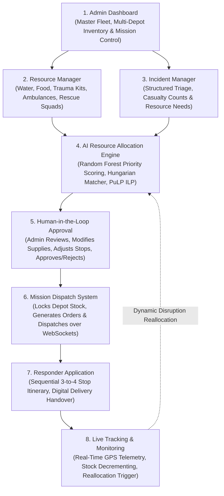
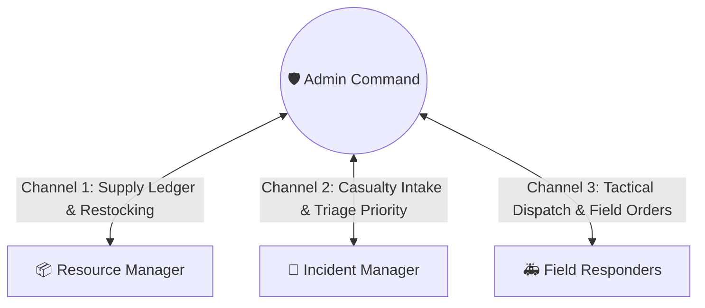

<div align="center">
  
  <h1>CrisisCore</h1>
  <p><strong>Autonomous Disaster Logistics, Multi-Agency Incident Triage & Real-Time Emergency Command System</strong></p>

  [](android/)
  [](ml/)
  [](https://vitejs.dev/)
  [](https://nodejs.org/)
  [](https://socket.io/)
  [](LICENSE)
</div>

<br/>

**CrisisCore** is an end-to-end, real-time disaster management and emergency logistics platform. Built upon an **8-stage closed-loop operational pipeline** and an **Admin 3-Channel Communication Hub**, the system connects distressed citizens, multi-depot relief warehouses, emergency dispatchers, and field rescue teams under sub-15ms event latency.

---

## 🏛️ System Architecture

### 1. The 8-Stage Disaster Logistics Pipeline
CrisisCore structures emergency operations into eight synchronized, deterministic stages:



### 2. Admin 3-Channel Communication Topology
To prevent radio congestion and data leaks during acute crises, operational communications are split into three isolated Socket.IO channels:



---

## 🚀 Key Functional Modules

### 1. Resource Manager (Relief Consumables + Fleet)
- Tracks physical consumable stock across regional depots:
  - **Drinking Water** (Litres)
  - **Emergency Food Rations** (Meal packs)
  - **Medical Trauma Kits** (ALS/BLS kits)
  - **Emergency Ambulances** (Type-A Rapid Response)
  - **Search & Rescue Squads** (Trained teams)
  - **Heavy Disaster Equipment** (Sump pumps, cutting rigs)
- Instant warehouse replenishment module with real-time database persistence.

### 2. Incident Manager (Structured Intake & Dynamic Triage)
- Ingests emergency distress calls via citizen portal (`sos.html` and in-app `#civilianView`).
- Captures exact casualty numbers, emergency category (`MEDICAL`, `FIRE`, `COLLAPSE`, `FLOOD`, `SECURITY`, `HAZMAT`), situational notes, and structured **Resource Needs**.
- Sub-second NLP priority scoring assigns calibrated urgency tiers (`CRITICAL`, `HIGH`, `MEDIUM`, `LOW`).

### 3. AI Resource Allocation Engine (Weeks 4 & 5)
- **Machine Learning Priority Model ([`ml/priority_model.py`](ml/priority_model.py))**:
  - Calibrated **Random Forest Classifier** trained on multi-modal emergency datasets with TF-IDF NLP n-gram embeddings and standardized casualty indicators.
  - Generates continuous urgency scores ($0.00$ to $1.00$), class probabilities, and human-readable decision factors.
- **Multi-Depot Proximity Matcher ([`ml/resource_matcher.py`](ml/resource_matcher.py))**:
  - Automatically matches incident demands with the nearest regional depots via Haversine distance, detects supply deficits, and calculates fulfillment ratios.
- **Hungarian Bipartite Dispatcher ([`ml/optimizer.py`](ml/optimizer.py))**:
  - Solves optimal 1-to-1 responder-to-incident pairing via `scipy.optimize.linear_sum_assignment` considering transit distance, urgency penalty, and vehicle specialization.
- **Integer Linear Programming (ILP) Solver ([`ml/optimizer.py`](ml/optimizer.py))**:
  - Uses `pulp` (CBC solver) to solve multi-commodity cargo distribution subject to vehicle payload weight constraints and depot stock bounds.
- **Sequential Route Planner ([`ml/router.py`](ml/router.py))**:
  - Generates 3-to-4 stop itineraries: **Depot Pickup $\rightarrow$ Incident Scene Delivery $\rightarrow$ Hospital/Base Return** with leg distances (km) and estimated travel times (mins).

### 4. Human-in-the-Loop Admin Approval (Week 6)
- AI recommendations are presented in an interactive review modal (`#humanApprovalModal`).
- The Admin holds full modification authority:
  - Adjust allocated supply quantities up or down.
  - Reassign the dispatched responder unit.
  - Inspect the sequential stop order and mission itinerary.
  - One-click **Approve & Dispatch** or **Reject**.

### 5. Field Responder Mobile Terminal (Weeks 7 & 8)
- Touch-friendly mobile interface for paramedics and rescue crews.
- Step-by-step sequential stop tracking with single-tap **Confirm Delivery at Stop**.
- **Closed-Loop Stock Decrementing**: Confirmed deliveries permanently deduct allocated supplies from the SQLite database in real time.
- **Dynamic Reallocation**: Single-tap vehicle breakdown trigger that automatically releases the incident and dispatches an alternate unit.

### 6. Native Android Mobile Application
- Packaged with **Capacitor 8.5** for high-performance native WebView execution.
- Features an off-canvas slide-out drawer menu (`#sidebarBackdrop`) and a thumb-accessible 5-tab bottom navigation bar (`Command`, `Map`, `SOS`, `Units`, `Menu`).
- Native hardware GPS integration with cross-platform network bridging (`http://10.0.2.2:3001` on emulator / LAN IP on physical phones).

---

## 🛠️ Technology Stack & Architecture Defense

| Component | Selected Technology | Alternative Considered | Why Selected? Why NOT Alternative? |
| :--- | :--- | :--- | :--- |
| **Frontend Core** | **HTML5 + Vanilla JS (ES6) + Vite** | React / Next.js | **Sub-millisecond DOM updates**, zero virtual DOM reconciliation overhead, instant load on low-powered mobile devices in disaster zones. React bundles add 300KB+ runtime overhead. |
| **Design System** | **Custom High-Contrast CSS (`#0a0f1d`)** | Tailwind CSS / Bootstrap | **Tactical dark theme** engineered specifically for emergency legibility; zero utility class bloat, GPU-accelerated drawer animations. |
| **Backend Gateway** | **Node.js + Express.js** | Python Django / Spring Boot | **Non-blocking asynchronous event loop** handles concurrent real-time I/O effortlessly. Single language across stack allows shared validation schemas. |
| **Real-Time Layer** | **Socket.IO (Engine.IO v4)** | Raw WebSockets | Built-in **rooms and namespaces** (`channel:1`, `channel:2`, `channel:3`), automated reconnection, and transparent HTTP long-polling fallback. |
| **Database & ORM** | **Prisma ORM + SQLite / PostgreSQL** | MongoDB / Raw SQL | **Strict relational integrity** between Users, Incidents, Allocations, and Delivery Confirmation logs. Type-safe queries prevent schema drift during rapid concurrent dispatches. |
| **AI / ML Engine** | **Python 3.12 + FastAPI + Scikit-Learn** | Pure LLM Prompting | **Sub-5ms deterministic inference** without API token costs or hallucination risk; calibrated probability distributions and feature importance metrics. |
| **Optimization Solver** | **PuLP (CBC) + SciPy Linear Assignment** | Manual Greedy Dispatch | Mathematical guarantees of minimal travel distance and maximum demand satisfaction under vehicle payload constraints. |
| **Mobile Runtime** | **Capacitor 8.5 (Android Bridge)** | Flutter / React Native | **100% codebase reuse** with zero UI drift, direct access to Android hardware GPS, single-command Gradle compilation. |
| **Tactical Mapping** | **Leaflet.js + CartoDB Dark Matter** | Google Maps API | **100% open-source, zero API cost/rate limits**, offline tile caching support, and ultra-lightweight (<40KB) footprint. |

---

## 📂 Repository Directory Structure

```
CrisisCore/
├── index.html                   # Master Command Center (Admin, Resource Manager, Incident Manager, Responders)
├── sos.html                     # Standalone Citizen SOS Emergency Intake Portal
├── package.json                 # Scripts: dev, build, server, ml:train, ml:start, android:sync
├── capacitor.config.json        # Android native WebView and cleartext HTTP bridge config
├── src/
│   ├── main.js                  # Frontend controllers (Human-in-the-Loop modal, 3 channels, inventory ledger)
│   ├── sos.js                   # Public SOS intake & live GPS streaming
│   ├── apiConfig.js             # Dynamic cross-platform network & emulator routing
│   └── style.css                # Tactical dark-theme design tokens & responsive drawer layouts
├── android/                     # Native Android Studio Gradle Project (Capacitor)
│   └── app/src/main/            # AndroidManifest.xml (GPS permissions, cleartext HTTP config)
├── server/                      # Express + Socket.IO Backend Server
│   ├── src/
│   │   ├── index.js             # Gateway entry & WebSocket room setup
│   │   ├── routes/              # REST routes: /incidents, /resources, /assignments, /chat, /auth
│   │   ├── services/
│   │   │   └── mlClient.js      # Bridge client connecting Express to Python FastAPI microservice
│   │   └── ws/
│   │       └── socketHandler.js # Real-time event broadcaster & channel room multiplexer
│   └── prisma/
│       ├── schema.prisma        # Relational database models (multi-depot stock, multi-stop missions)
│       └── seed.js              # Comprehensive multi-role disaster demo seed data
├── ml/                          # Machine Learning & Algorithmic Optimization Subsystem
│   ├── app.py                   # FastAPI microservice (/evaluate, /optimize, /route, /health)
│   ├── dataset.py               # Multi-modal emergency disaster dataset generator
│   ├── train_priority_model.py  # Model trainer & benchmark (Random Forest, Gradient Boosting, Logistic)
│   ├── priority_model.py        # Production inference & calibrated urgency scoring
│   ├── resource_matcher.py      # Multi-depot proximity relief inventory matcher
│   ├── optimizer.py             # Hungarian Bipartite Matcher & PuLP ILP solver
│   ├── router.py                # Sequential multi-stop mission route planner
│   ├── requirements.txt         # Python dependencies (scikit-learn, pulp, fastapi, uvicorn)
│   └── models/
│       ├── priority_classifier.joblib  # Serialized production pipeline
│       └── metrics.json                # Benchmark results and classification reports
└── screenshots/                 # Verified interface screenshots for presentations & reports
```

---

## ⚡ Quick Start Guide

### 1. Prerequisites
- **Node.js**: v18+ (v20+ recommended)
- **Python**: v3.10+ (v3.12 recommended)
- **Android Studio** *(Optional, for Android APK compilation)*

### 2. Installation & Database Setup
```bash
# Clone the repository
git clone https://github.com/RghavSrdhtra/CrisisCore.git
cd CrisisCore

# Install root dependencies
npm install

# Install backend dependencies
cd server
npm install

# Push database schema & seed demo data
npm run prisma:push
npm run prisma:seed
cd ..

# Install Python ML dependencies
pip install -r ml/requirements.txt
```

### 3. Running the System Services

Open three terminal tabs to run the full stack:

**Terminal 1 — Python AI & Optimization Microservice (Port 8000):**
```bash
npm run ml:start
# Running on http://127.0.0.1:8000
```

**Terminal 2 — Node.js Express Gateway & WebSockets (Port 3001):**
```bash
npm run server
# Running on http://localhost:3001
```

**Terminal 3 — Frontend Web Console (Port 5173):**
```bash
npm run dev
# Running on http://localhost:5173
```

### 4. Running the Android Application
```bash
# Synchronize frontend build with Android assets
npm run android:sync

# Open project in Android Studio
npm run android:open
```
*Run on any connected physical Android device or Android Virtual Device (AVD). The app automatically bridges to your local PC backend via `http://10.0.2.2:3001`.*

---

## 🔑 Demo Personas & Pre-Configured Test Accounts

| Persona | Role | Default Email | Password | Primary Console |
| :--- | :--- | :--- | :--- | :--- |
| **Marcus Wright** | `ADMIN` | `admin@crisiscore.dev` | `admin123` | Master Command Center, Human-in-the-Loop Approval, 3-Channel Comms |
| **Dev Sharma** | `COORDINATOR` | `coord@crisiscore.dev` | `coord123` | Tactical Triage, Incident Dispatch, Live Map Telemetry |
| **Sarah Jenkins** | `RESOURCE_MANAGER` | `resource@crisiscore.dev` | `resource123` | Multi-Depot Inventory Ledger, Quick Stock Replenishment |
| **Priya Patel** | `INCIDENT_MANAGER` | `incident@crisiscore.dev` | `incident123` | Live Incident Feed, Severity Overrides, Resource Demands |
| **Carlos Vance** | `RESPONDER` | `responder@crisiscore.dev` | `resp123` | Responder Terminal (`MEDIC-01`), Stop Itinerary, Delivery Confirmation |
| **Jane Doe** | `CIVILIAN` | `civilian@crisiscore.dev` | `civilian123` | SOS Emergency Portal, Voluntary GPS Sharing, 4-Stage Tracker |

---

## 🧪 Testing the 8-Stage Pipeline End-to-End

Run the automated end-to-end integration test:
```bash
python scratch/test_e2e_integration.py
```
This script executes all 8 stages sequentially:
1. Queries live depot inventory in SQLite.
2. Submits an SOS distress signal with text descriptions and requested supplies.
3. Triggers the Python Random Forest model for NLP priority evaluation.
4. Invokes Hungarian matching and PuLP ILP to pair the optimal vehicle and depot stock.
5. Generates a 3-stop sequential mission itinerary.
6. Executes Admin approval to lock inventory and issue WebSocket dispatches.
7. Simulates responder arrival at the scene and confirms delivery.
8. Verifies that warehouse stock is permanently decremented in real time.

---

## 📄 License
This project is licensed under the MIT License — see the [LICENSE](LICENSE) file for details.
